# Sofia Public Transport — lines 280 and 64

A 3D bus simulator of two Sofia bus lines, with four bus types modelled after reference photos:

| Line | Route | Length | Stops | Buses (dispatched per service) |
| --- | --- | --- | --- | --- |
| **280** | СУ „Св. Климент Охридски“ ↔ Студентски град | 10.7 / 10.3 km | 18 / 18 | MAN Lion's City G CNG and Mercedes-Benz Conecto G (orange, diesel) |
| **64** | Зоопарка ↔ Център по хигиена | 16.4 / 15.8 km | 35 / 33 | BMC Procity 12 CNG and Yutong ZK6126HGA (orange CNG) |

The whole game is **one HTML file** (`index.html`, also copied to
`dist/sofia-public-transport.html`). Open it in a desktop or mobile browser with WebGL2. It
works offline: no server, CDN or network access is needed.

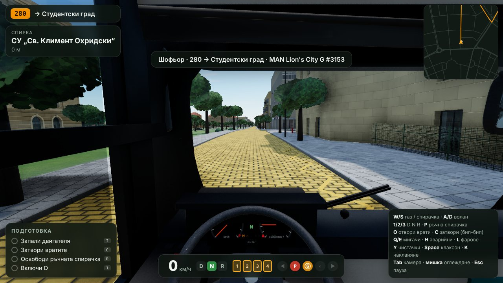

| | |
| --- | --- |
| 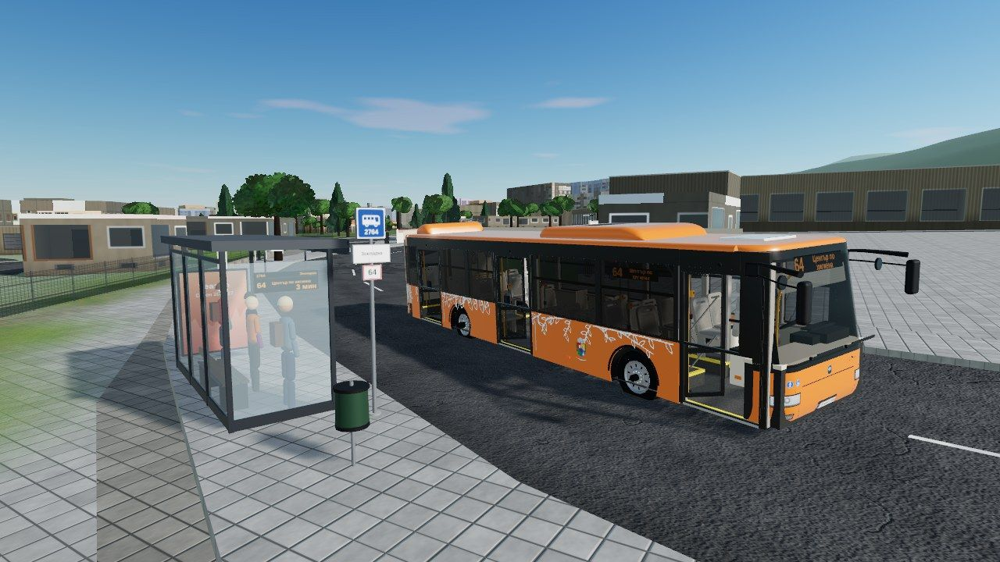 | 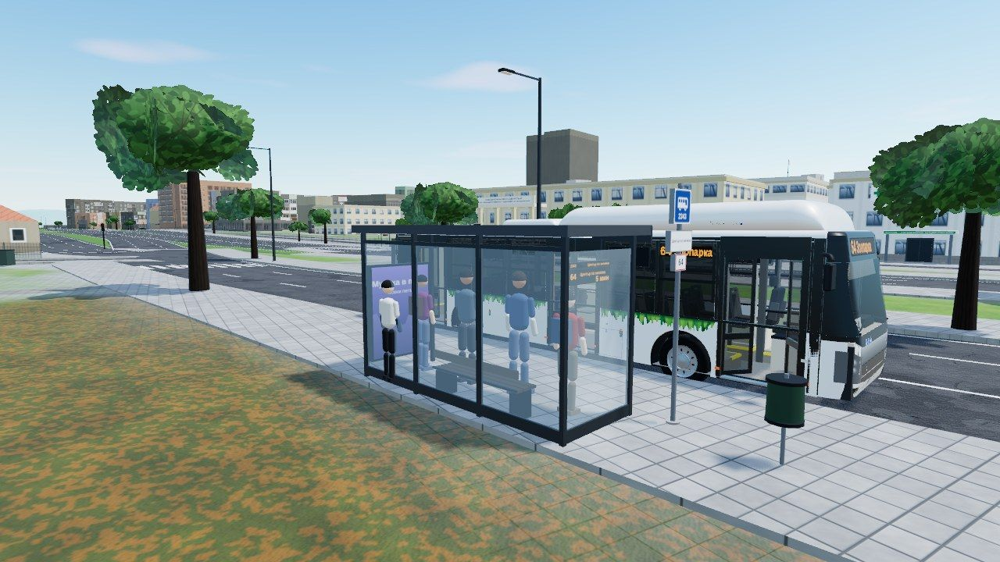 |
| 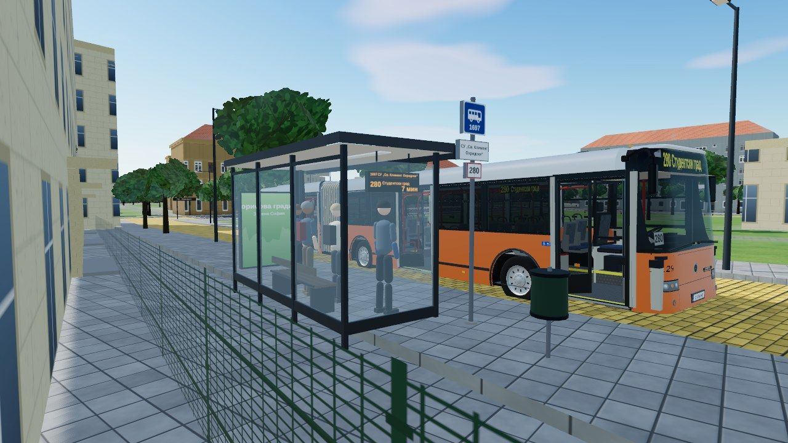 | 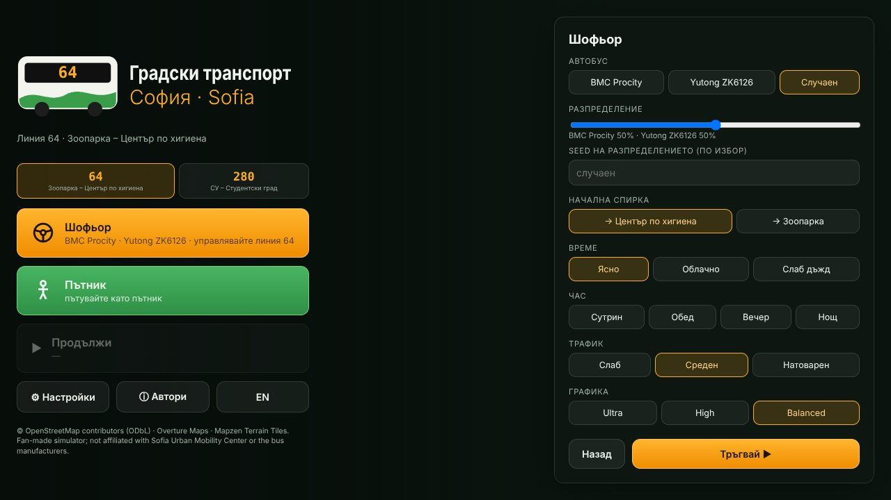 |
| 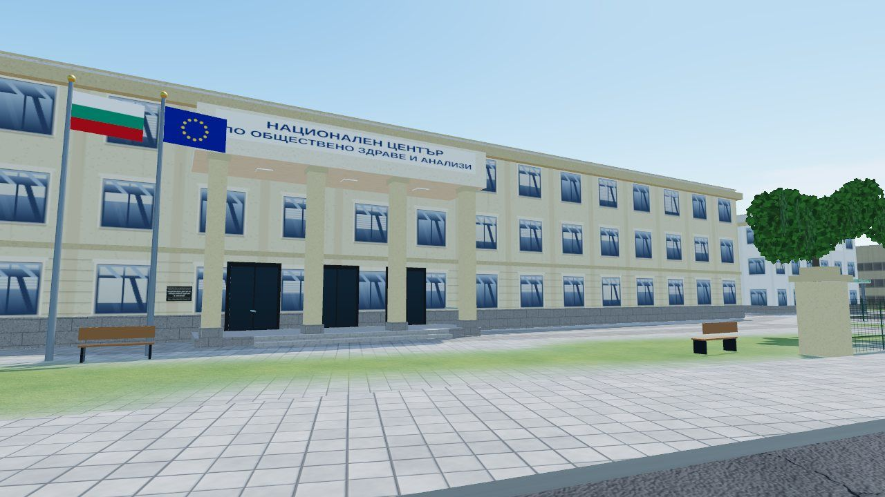 | 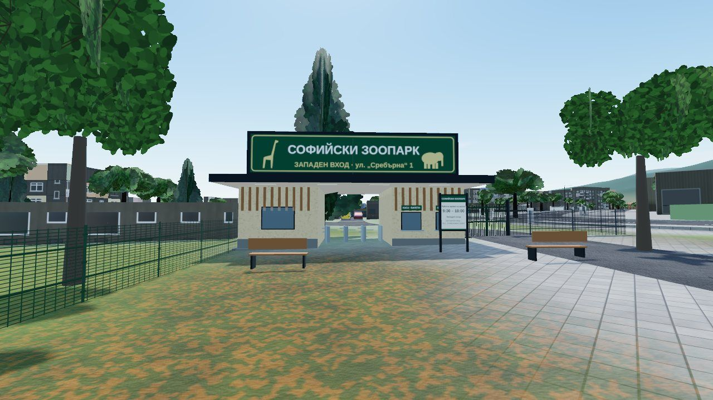 |
| 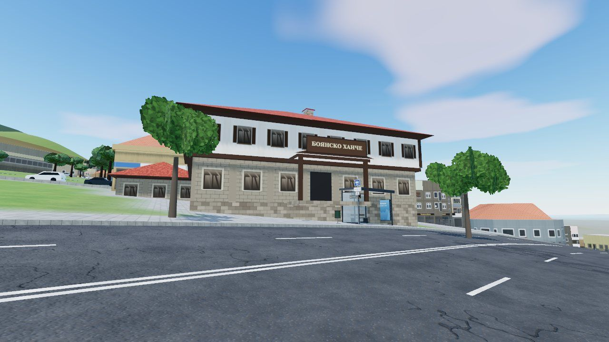 | 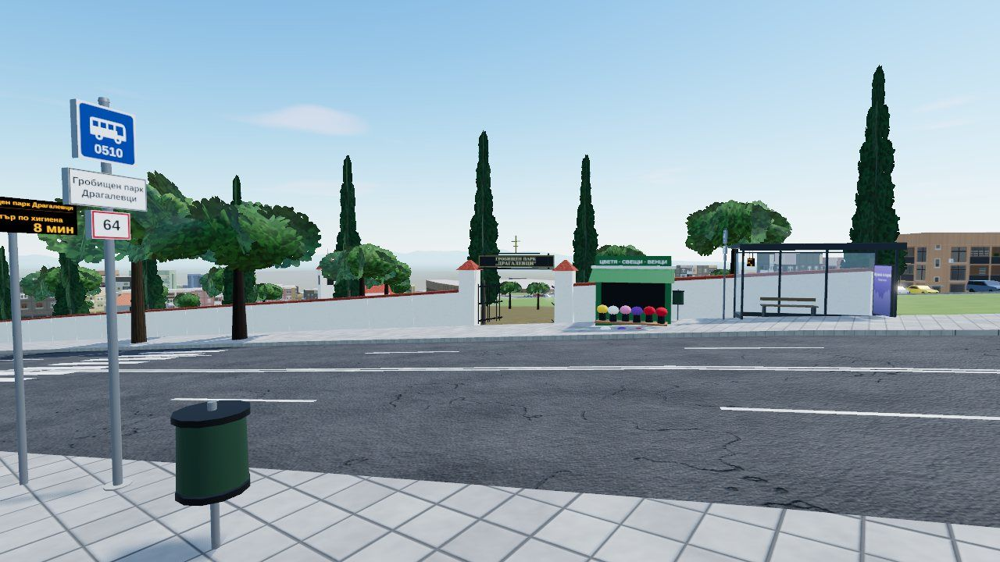 |
| 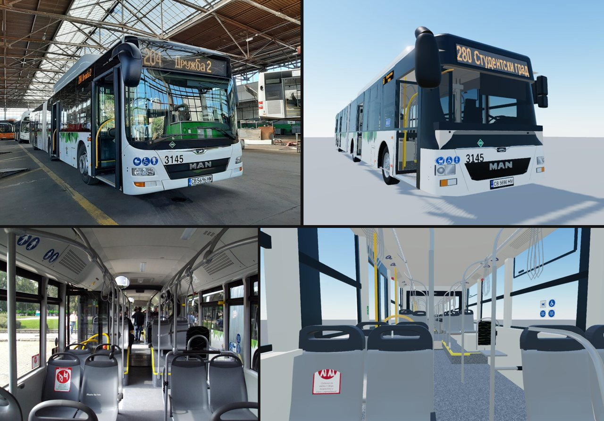 | 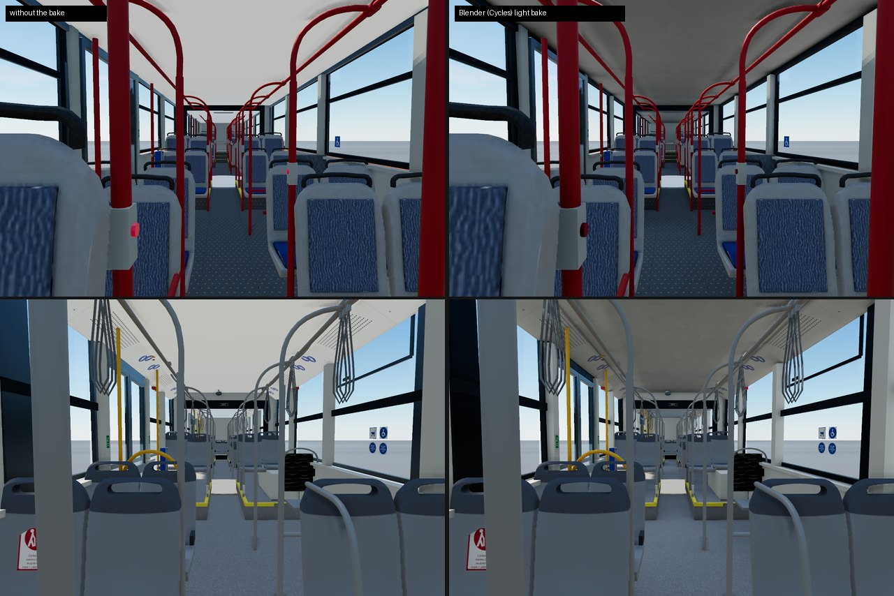 |
| 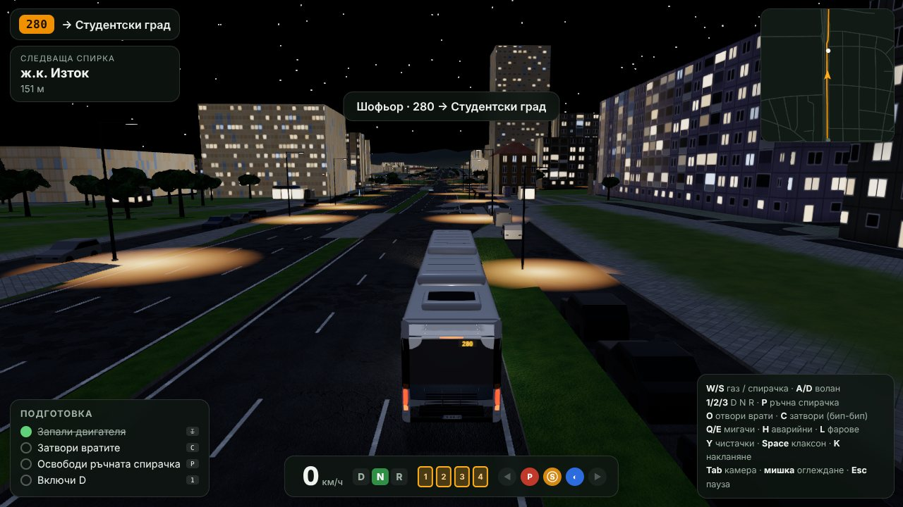 | 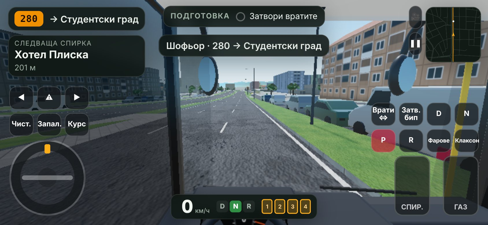 |
| 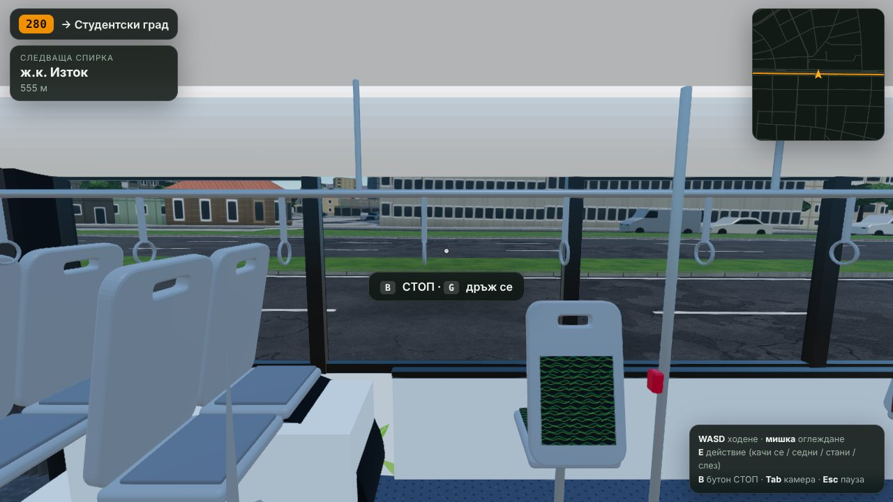 | |

## Playing

Open `index.html`, pick the **line** (64 or 280) on the main menu, then **Шофьор** (driver)
or **Пътник** (passenger). On the setup screen choose the bus, the direction, the weather,
the time of day, the traffic density and the graphics preset, then start. Switching line
reloads the page with that line's map.

### Buses and dispatch

Each line has its own fleet; a bus never appears on the other line.

| Bus | Line | Type | Engine | Doors | Cab |
| --- | --- | --- | --- | --- | --- |
| MAN Lion's City G CNG | 280 | 18 m articulated | CNG | 4 | dial cluster, two-beep door warning |
| Mercedes-Benz Conecto G (O 345 G) | 280 | 18 m articulated | diesel (OM 457) | 3 | VDO round gauges, single buzzer |
| BMC Procity 12 CNG | 64 | 12 m rigid | CNG (Cummins ISL G) | 3 | LCD cluster |
| Yutong ZK6126HGA | 64 | 12 m rigid | CNG | 3 | LCD cluster |

Each bus has its own dimensions, door positions, physics (torque curve, gearbox, mass,
steering lock), engine sound profile and door warning. In the menu, pick one bus or
**Случаен** (random). Random dispatch decides **per service**: every new trip (your next run
in driver mode, every bus that comes in passenger mode) draws a bus from the line's fleet,
by default 50 / 50. The **share slider** changes the split and the **seed** field makes the
sequence reproducible (the same seed gives the same buses in the same order).

### Driver mode

- **Before departing:** start the engine (**I**), close the doors (**C**), release the
  parking brake (**P**), then select **D** (**1**).
- **Stops:** pull in to the kerb at each stop with the front door at the stop pole,
  open the doors (**O**), wait for boarding and alighting, then close them (**C**).
- **Request stops** (line 64: Скиорката, Резиденция Бояна, Гробищен парк Бояна): the HUD and
  the announcement say „по желание“. Stop only when somebody waits there or a passenger
  presses STOP; driving past an empty request stop costs nothing.
- **Door closing:** close request → the bus's warning (beeps or buzzer) → the leaves close.
  Anyone in the doorway makes them reopen.
- **Interlock:** while any door is open, the throttle is cut and the bus-stop brake holds
  the bus.
- **Scoring:** comfort (jerk and lateral g), speed limits, kerb strikes, stop accuracy,
  red lights and punctuality against the timetable.
- **Terminal:** at the end of the line the destination signs switch over, and you can
  drive the return trip.

| Key | Action |
| --- | --- |
| W / S, arrows | throttle / brake |
| A / D | steer |
| 1 / 2 / 3 | D / N / R |
| P | parking brake |
| O / C | open doors / close doors |
| F | open the front door only |
| Q / E | indicators |
| H | hazard lights |
| L | headlights |
| Y | wipers (off / interval / fast) |
| K | automatic kneeling at stops on / off |
| T | destination sign: route / depot / off |
| R | recover onto the route (when stopped) |
| Space | horn |
| Tab | camera (cab, follow, front, side, articulation joint, free) |
| mouse | look around (look down for the instrument cluster) |
| Esc | pause |

### Passenger mode

You start on the pavement at a real stop on the chosen line. A bus arrives about every
two minutes with its own AI driver (which bus it is follows the dispatch setting); the HUD
and the stop's e-board count down its arrival. If you miss it, or after you get off, the
next one is already on its way.

| Key | Action |
| --- | --- |
| WASD | walk |
| mouse | look |
| E | board when near an open door; inside, sit (aimed seat or the nearest free one) or stand up; get off when standing in an open doorway |
| B | stop request (bell) — needed to get off at a request stop |
| G | hold on |
| Tab | eyes or cinematic camera |

Inside the articulated buses you can walk through the bellows into the rear section.
Other passengers board, sit, stand and get off. The on-board display and the
announcements give the next stop.

### Browser support

The game needs WebGL2: any current Chrome, Edge, Firefox or Safari (iOS 15+), desktop or
mobile.

- **Map decompression:** uses the browser's `DecompressionStream`. On older Safari and
  WebViews a built-in JavaScript inflater takes over.
- **Engine sound:** uses an AudioWorklet, with an oscillator fallback.
- **Voice:** the Bulgarian voice depends on the voices installed on the device; see
  [Announcements and voice](#announcements-and-voice).

### Touch devices

Phones and tablets get on-screen controls automatically: a steering wheel, pedals, a
gear selector, door buttons and a camera button for the driver, and a walk stick plus
action buttons for the passenger. The controls respect the safe areas of
notched screens. Force the touch layout on desktop with `?touch`.

## Settings

| Setting | Options |
| --- | --- |
| Line | 64 or 280 (main menu) |
| Bus | per line: one bus type or random, with the share slider and the dispatch seed |
| Language | Bulgarian (default) or English UI (БГ/EN button on the main menu) |
| Graphics | quality preset **Ultra / High / Balanced** (auto-detected on first start, changeable on the trip setup screen), render scale, FPS counter |
| Audio | master, engine, voice, ambience and effects volumes |
| Voice | Bulgarian voice selection and a test button |
| Door beep | frequency of the MAN's beep, with a test button (the other buses use their own warning) |
| Controls | mouse sensitivity, invert Y, gyro steering on phones, touch control size |

Settings and progress are stored in `localStorage` in the browser.

URL parameters for testing:

| Parameter | Effect |
| --- | --- |
| `line=64\|280` | line (and its map) |
| `veh=man\|conecto\|procity\|yutong` | force a bus (must belong to the line) |
| `seed=abc` | reproducible random dispatch |
| `q=ultra\|high\|balanced` | quality preset |
| `h=21.5` | time of day |
| `w=clear\|cloudy\|rain` | weather |
| `autostart=driver\|passenger` | skip the menu |
| `dir=A\|B` | direction |
| `stop=N` | passenger start stop |
| `fleet=3145` | fleet number |
| `touch` | force touch controls |
| `scene=bus` | bus model studio (with `veh=`) |
| `memlog` | log heap per loading stage |

## Announcements and voice

The stop announcements are in Bulgarian, for both directions of both lines:

- **„Следваща спирка X.“** shortly after leaving a stop.
- **„Спирка X.“** on approach. The trigger distance grows with speed, and messages
  never overlap.
- At a request stop the announcement adds **„Спирка по желание.“**

A pronunciation dictionary (`src/audio/pronounce.js`) expands abbreviations and numbers
before speaking: „ж.к.“ → „жилищен комплекс“, „в.з.“ → „вилна зона“, „бул.“ → „булевард“,
„ул. 10“ → „улица десет“, „Акад.“ → „академик“ and so on.

The voice is chosen in this order:

1. **Embedded clips** in `src/data/voice-clips.json`. This file is **empty in this
   build**. Generate it with `tools/generate_announcements.py` (Azure
   `bg-BG-KalinaNeural`, Google `bg-BG`, or your own recordings), then rebuild.
2. **The device's Bulgarian voice** (Web Speech API), preferring female voices.
3. **Text only:** a chime plus subtitles when the device has no Bulgarian voice.

The game never reads Bulgarian with an English voice. See [docs/AUDIO.md](docs/AUDIO.md).

## Building

```sh
npm install           # esbuild + three
npm test              # unit tests: route, stops, announcements, doors, dispatch, pronunciation, state machine, swept path, gzip fallback, lightmap layout
npm run build         # -> index.html and dist/sofia-public-transport.html (single file)
node build.mjs --dev  # unminified with inline source maps
```

Checks in headless Chromium (SwiftShader):

```sh
bash tools/smoke.sh index.html                                # driver, passenger and bus studio load without errors
LINE=64 VEH=procity node tools/route_check.cjs index.html A    # AI drives a whole direction, every stop must be served
python3 tools/compare_bus.py index.html out/                  # the MAN next to the reference photos
python3 tools/stop_views.py index.html out/ 2342 2764 --line=64   # street views at stop poles
```

Rebuilding the map data from scratch (Python 3 with `pyarrow`, `shapely`, `numpy`,
`Pillow`) downloads Overture Maps and terrain tiles:

```sh
npm run data          # tools/rebuild_data.sh (line 280)
python3 tools/build_route.py <datadir> src/data/route64.json 64   # line 64 route and stops
node tools/make_manifest.mjs
```

## 3D assets made in Blender

The game is one offline HTML file drawn by three.js (WebGL2). Unity and Unreal Engine 5 are not
used: neither is available in the build environment, Unreal Engine 5 has no web export, and a Unity
WebGL build is a separate multi-file player, not a scene inside this single file. **Blender 5.2**
(its Python module `bpy`) does the offline modelling and baking instead, and three.js loads the
results:

| Script | Output | What it makes |
| --- | --- | --- |
| `tools/blender/kit_facade.py` | `src/data/kit_facade.glb` | facade and roof pieces for the buildings along the routes: split-AC units, dishes, downpipes, TV masts, vents, lift rooms, awnings, lamps, chimneys, roller shutters, window bars, washing racks, window boxes, gas pipes |
| `tools/blender/kit_landmark.py` | `src/data/kit_landmark.glb` | sculpture and ornament for the landmarks: bronze eagles, stone lions, robed and seated figures, Corinthian capitals, fluted shafts, column bases, balusters |
| `tools/blender/kit_bus.py` | `src/data/kit_bus.glb` | bus parts: 275/70 R22.5 tyre, steel and polished aluminium wheels, the seat shells of all four buses, hand straps, the Sofia validator, the MAN mirrors, the steering wheel |
| `tools/blender/bake_bus_light.py` | `src/data/lightmaps/*.webp` | baked light for the body and cabin of every bus (Cycles) |

Every kit piece is a detailed high-poly model (bevels, lettering, tread, grilles, fabric relief)
baked onto a game mesh: albedo with contact shading, a normal map, ambient occlusion,
roughness and metalness, in one atlas per kit.

The **bus light bake** does for the buses what baked lighting does in Unreal or Unity. Each bus
is exported from the game (`tools/bus_lightmap_export.cjs`), lit in Cycles by a uniform sky with
three diffuse bounces, and the fraction of the open-sky light that reaches every point of the body
and the cabin is stored in a lightmap. In the game it scales the sky and environment light of those
parts while the sun and its shadows stay live: dark under the seats and in the door wells, bright
beside the windows, contact shading round the bumpers, the wheel arches and the roof pods. The
lightmap UVs are computed from the geometry (`src/vehicle/BusLightmap.js`) the same way at export
and at run time, so they are not stored. A signature of the geometry is baked with each map. After a
change to a bus model, bake again; until then, a map that no longer matches is ignored and the bus
keeps its unbaked lighting.

```sh
pip install bpy==5.2.3 numpy pillow                    # Python 3.13
python tools/blender/kit_bus.py                         # one kit (also kit_facade.py, kit_landmark.py)
BLENDER_PY=python bash tools/bake_bus_lightmaps.sh      # light bake of all four buses (about 20 min on 4 cores)
```

## Data and accuracy

- **Map data:** roads, buildings, stops, signals, crossings, trees and land use come from
  **OpenStreetMap** via **Overture Maps** (ODbL, © OpenStreetMap contributors).
- **Elevation:** Mapzen/AWS Terrarium tiles.
- **Stops:** matched by their official stop codes; each direction is routed independently
  on the real one-way street network.
- **Line 64:** the stop lists of both directions, the request stops and the terminus
  arrangement (direction B ends at stop 0749 on the zoo loop, direction A starts at 2764)
  are documented with their sources in `data/research/line64/README.md`.
- **No Google data:** no Google Maps or Street View imagery or data is used, and no
  photograph is used as a texture: every texture is drawn procedurally, in code or baked in
  Blender from procedural materials.
- **Buses:** measured from the reference photos supplied with the request. Each model has
  a `NOTES.md` in `src/vehicle/models/<bus>/` that separates measured numbers, published
  data and approximations. The Yutong's fleet numbers are placeholders.
- **Landmarks:** hand-built on their OSM footprints along both lines — hospitals,
  universities and the sports academy on 280; the metro station Vitosha, Paradise Center,
  the National Centre of Public Health and Analyses, the zoo's western entrance, Боянско
  ханче, the Boyana and Dragalevtsi cemeteries, the Boyana film studio gate and the Ring Road
  gantries on 64. The Boyana Residence is modelled only as its public perimeter along the
  road. What is verified and what is inferred is listed in
  `data/research/line64/landmarks/NOTES.md` and `data/research/world/institutions280/NOTES.md`.
- **Buildings and stops:** researched stop by stop on line 280 (`data/research/world/`).
  Elsewhere buildings are typed by typology and marked low confidence.
- **Shop signs:** real businesses near the route (Overture places), mounted on the
  building they are in.

## Code layout

| Folder | Contents |
| --- | --- |
| `src/core` | projection, maths, path sampling, seeded random |
| `src/gameplay` | route data, stop manager, announcements, destination display, bus entity, AI driver, traffic, pedestrians, scoring, state machine (pure logic is unit-tested) |
| `src/vehicle` | vehicle registry and dispatch (`Vehicles.js`), articulated / rigid physics, door controller, LED signs; `models/` holds the four bus models |
| `src/world` | heightfield, terrain, road network and meshes, buildings (archetype facade shader, real balconies, shop signs), street furniture and stop hardware, vegetation, landmarks (`landmarks64/` for line 64), spatial index |
| `src/render` | renderer and post-processing, sky, cameras, procedural textures, weather, bus lights |
| `src/audio` | synthesised bus sound with per-bus engine profiles, five listener zones, all buses audible with distance and Doppler, door and brake one-shots, ambience; voice announcer and pronunciation dictionary |
| `src/ui` | HUD, menus, input, touch controls, i18n |
| `src/game` | game modes, settings |
| `tools` | data pipeline, headless screenshot and route-check harness, manifest and announcement generators; `tools/blender` the Blender kits and the bus light bake |
| `tests` | `node --test` unit tests |

Progress log: [docs/PROGRESS.md](docs/PROGRESS.md).

## Licences

- **Code:** in this repository.
- **Map data:** © OpenStreetMap contributors, ODbL 1.0, via Overture Maps Foundation.
- **Three.js:** MIT.
- **Liveries and logos:** the bus liveries, badges and graphics are drawn procedurally as
  an approximation for this simulator. They are not the operators' or manufacturers'
  artwork. This is a fan-made simulator, not affiliated with Sofia's Urban Mobility Center,
  the operators or the bus manufacturers.
